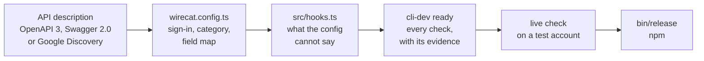

<p align="center">
  
</p>

# cli-template: turn an API into a CLI for AI agents

<p align="center">
  Turn an API description into a CLI your agent can use in Claude Code, Codex or any app that speaks MCP. One
  command gives you the CLI with an MCP server, and a test for every operation of the API. When the template
  improves, its upgrade command merges the change into the CLI you already edited.
</p>

<p align="center">
  
</p>

<p align="center">
  <a href="https://wirecat.dev/en/docs/build-create-cli">Docs</a> ·
  <a href="https://github.com/WireCatLabs/cli-template/blob/main/kit/README.md">Reference</a> ·
  <a href="https://discord.gg/DebENqbRrJ">Discord</a>
</p>

<p align="center">
  <a href="https://www.npmjs.com/package/@wirecat/cli-template"></a>
  <a href="https://github.com/WireCatLabs/cli-template/actions/workflows/main.yml"></a>
  <a href="https://github.com/WireCatLabs/cli-template/blob/main/LICENSE"></a>
</p>

<!-- cspell:words amo amoCRM bitrix Kommo beeline gcal hubspot ydisk openclaw -->

- **Your agent gets the whole API on day one.** Every operation of an OpenAPI 3, Swagger 2.0 or Google Discovery
  description becomes a command that the MCP server and the agent skill run, with a page in the skill.
- **You stay in charge of what it does.** Each command and each API operation has a permission, every delete has its
  own, and the token stays in your system keyring.
- **The CLI keeps up after you edit it.** `upgrade` merges the template's CI, release and agent files into your copy,
  and updates of cli-core bring the fixes to the code. Your own commands are never touched.

From PokeAPI's published description to 102 commands, a real answer and a working MCP server took 16 seconds with an
empty pnpm store and 12 with a warm one, not counting npx's own download. Nine of WireCat's own CLIs are made from
the template, see [CLIs built with it](#clis-built-with-it).

## Quick start

There are two ways in. Pick the one that fits what you have.

| You have | Start with | You get |
| --- | --- | --- |
| The address of the service's API description | `new --spec-url <url>` | A CLI with one command per operation, the MCP server and the skill |
| An API description and a few lines saying how its records map to people and companies | `new --from-config wirecat.config.ts` | The same, plus sign-in, `sync` into a local copy and the category's contract tests (CRM today) |
| An agent and no time | `npx skills add WireCatLabs/cli-template` | Your agent finds the description and runs `new --spec-url` for you |

### From an API description

```sh
npx @wirecat/cli-template new poke-cli --preset generic --owner example --sign-in none \
  --spec-url https://raw.githubusercontent.com/PokeAPI/pokeapi/d19c710/openapi.yml
cd poke-cli && pnpm install && pnpm generate
node dist/bin/poke.js personal api pokemon-get --id pikachu --json=name,height,weight
node dist/bin/poke.js personal mcp add claude-code --allow-writes
```

Put your own GitHub name in `--owner` and the address of your service's description in `--spec-url`, JSON or YAML.
`--preset generic` answers the questions only WireCat's own tools need, and any flag you give wins. Without it, `new`
asks for every missing answer and never guesses one. `--allow-writes` is there because the template's sample
`comments` commands can write, and `mcp add` refuses a profile with writes until you say so.
`npx @wirecat/cli-template remove-sample` drops the sample.

### From a config

One file says which service it is, where its API description lives, how to check a token, and how the service's
records map to people, companies and deals. `new` builds the CLI from it, and the CLI keeps the file as the one place
to edit.

```ts
import { defineCli } from "@wirecat/cli-core/manifest"

export default defineCli({
  identity: { command: "acme", package: "@wirecat/acme-cli", prefix: "WCACME", service: "Acme", owner: "WireCatLabs" },
  spec: { kind: "openapi", from: "https://acme.example/openapi.json" },
  auth: { preset: "token", verify: { operation: "getMe", id: "workspace.id", name: "workspace.name" } },
  category: "crm",
  source: { provider: "acme", kinds: ["person"], entities: { person: { … } } },
})
```

```sh
npx @wirecat/cli-template new --from-config wirecat.config.ts
cd acme-cli && pnpm install && pnpm generate
node dist/bin/acme.js work session start    # takes the token and checks it with auth.verify
node dist/bin/acme.js work sync             # copies the records in, then only what changed
```

In a terminal, `new` asks for the answers the config does not hold, such as the content languages. A script or an
agent passes them as flags, listed in the [kit reference](kit/README.md#new-name). Outside WireCat, use your own
scope in `package` and your own name in `owner`. This path needs a real account and its token, since
`session start` checks the token against the service. The shape of `source` is `CrmManifest` in
`@wirecat/cli-core/manifest`.

## Why a CLI and MCP

- **An agent with a terminal runs it like you do.** Claude Code or Codex read `--help`, ask `--json=name,height` for
  only the fields they need, and chain commands in a script.
- **An app without a terminal gets the same commands over MCP.** Claude Desktop, Cursor and others connect to
  `mcp serve`, and ChatGPT or Claude in the browser through `mcp serve --http` behind your own tunnel.
- **You can repeat what the agent did.** It is the same command, with the same permissions, so you check a result by
  running it yourself. A command that fails is kept as a run, and `runs show` tells you what was run.

| Agent | How to connect |
| --- | --- |
| Claude Code, Codex | `<cli> <profile> mcp add claude-code` or `mcp add codex` (`--allow-writes` for a profile that may write), and `<cli> skill install` |
| Claude Desktop, Cursor | `<cli> <profile> mcp config` prints the entry to paste |
| ChatGPT, Claude in the browser | `<cli> <profile> mcp serve --http --public-url <your tunnel>` |
| Gemini CLI, OpenClaw, Hermes | `<cli> skill install --for agents` (or `--for hermes`) |

## What it fixes

| What goes wrong with an API wrapper | What the template does |
| --- | --- |
| A one-time generator leaves you to copy its later fixes by hand | `upgrade` merges each template change file by file and asks before it touches a file you changed. `src/`, `scripts/` and `docs/` are yours and never touched |
| An agent deletes something you did not mean it to | Each profile sets `allow`, `ask`, `readonly` or `deny` per command and per API operation. A delete needs its own permission key, and the api group refuses to start without one. `--dry-run` shows what would run. Over MCP nobody can answer `ask`, so it runs: give the profile you serve `readonly` or `deny` where it matters |
| The token sits in a `.env` file | It stays in the OS keyring, under a profile you name, such as `personal` or `work`. No profile is ever assumed: a command without one stops and lists the profiles |
| The service changes its API | `pnpm spec:sync` downloads the description again, and `pnpm generate` follows |
| "It worked on my machine" | `src/api.test.ts` sends every operation to a fake built from the description, which refuses a request the description does not allow |

## What you get

```text
poke-cli/
├── spec/poke/openapi.yaml       the API description, and where it came from
├── wirecat.config.ts            with --from-config: the one file to edit
├── src/generated/               types, schemas and a manifest of every operation
├── src/commands/                the api group, the sign-in and your own commands
├── src/hooks.ts                 yours to add, named by `hooks` in the config: what the config cannot say
├── src/api.test.ts              every operation sent to a strict fake of the API
├── src/crm-contracts.test.ts    with a CRM config: cli-core's contracts for the category
├── contracts/wirecat.json       what WireCat Desktop reads to show and run the tool
├── skills/                      the agent skill, with pages for the API
├── .github/workflows/           CI, the release and a monthly check
└── bin/release                  publishes each version to npm through GitHub
```

A CLI with a source, such as a CRM made from a config, also gets what cli-core gives every WireCat tool. It keeps a
local copy that `sync` updates with only the changes, so its lists and search can answer from the copy, also
offline. A contact joins a person from your other WireCat tools by the same email, and `search all` finds them
together. A CLI made only from a description has no store and no search. It calls the service live.

## How it works



1. **The description.** `new --spec-url` downloads an OpenAPI 3 or Swagger 2.0 description (https, or http from
   localhost, at most 20 MB), puts its servers into the hosts
   the CLI may reach, and records the address and a hash in `spec/<command>/provenance.json`. `pnpm generate` writes
   one command per operation, its permission, its test and the skill's page. When the generator stops on part of the
   description, it names the place. Add a patch with its reason in `scripts/spec-model.ts`, as the
   [OpenAPI guide](kit/skills/new-cli/references/openapi.md) shows. A Google Discovery document goes in with
   `--spec discovery` and a line in `scripts/sync-spec.ts`.
2. **The config.** `wirecat.config.ts` says how to check a token and how the service's answers map to people,
   companies and deals. `pnpm generate` turns it into code that cli-core runs, so paging, cursors, the request budget
   and the store come from cli-core, not from code you write.
3. **The hooks.** What only this service does goes into `src/hooks.ts`, such as dropping old values of a field that
   keeps its history. The config names the file, and `pnpm source:check` checks every operation and path the config
   reads against the generated API.
4. **`cli-dev ready`.** It runs the CLI's checks in a fixed order and says for each one whether it is verified, with
   the evidence, and the one next step. A row is verified only by a script that passed, or by a live-check record of
   exactly this code. Nothing is inferred.
5. **The live check and the release.** `bin/live <account>` runs `scripts/live.sh` against a test account and records
   the pass. `bin/release` publishes to npm through GitHub.

How much of a source a config could cover, we estimated by reading the code of five WireCat CLIs written by hand
before the config existed (an estimate, give or take 10 points): between 42% (Bitrix24) and 87% (Google Drive),
with HubSpot at about 60%. The rest is the service's own logic, and it stays in hooks. Drive and Yandex Disk are
document sources, which a config does not cover yet.

## Tests that come with it

| Layer | What it proves | Where |
| --- | --- | --- |
| Every operation | The request each command sends is one the description allows, and a denied delete stops before anything is sent | `src/api.test.ts` |
| Sign-in, with `auth.verify` | `session start` checks the token with the operation the config names, and keeps nothing when the service refuses it | `src/commands/session.test.ts` |
| Category contracts | The source behaves like every CRM in WireCat, faults included. For example "a full list cut after its first page goes on from that page in a new run, nothing lost or repeated" and "a clock off by ten minutes either way loses no change" | `src/crm-contracts.test.ts`, from cli-core |
| Ready | Every check before a release ran and passed on this code | `pnpm exec cli-dev ready` |
| Live | The CLI works against the real service | `bin/live`, on a test account |

cli-core has contracts for CRM, files, calendar, mail and meetings. A config wires CRM's today. For the others you
write the source by hand and run the same contracts.

## CLIs built with it

All of them are WireCat's own, public, and made from this template.

| CLI | What it does |
| --- | --- |
| [hubspot-cli](https://github.com/WireCatLabs/hubspot-cli) | HubSpot CRM: a local copy of deals, contacts and companies, an MCP server and every CRM read of HubSpot's API |
| [bitrix24-cli](https://github.com/WireCatLabs/bitrix24-cli) | Bitrix24 CRM: deals and leads in a local store, any REST method, a permission on every write |
| [amo-cli](https://github.com/WireCatLabs/amo-cli) | amoCRM and Kommo: deals in a local store, any API v4 operation, a permission on every write |
| [notion-cli](https://github.com/WireCatLabs/notion-cli) | Notion pages and databases, searchable on your computer |
| [ydisk-cli](https://github.com/WireCatLabs/ydisk-cli) | Yandex Disk: search the folders you choose, and work with the files live |
| [mail-cli](https://github.com/WireCatLabs/mail-cli) | Any IMAP mailbox copied to your computer and searchable offline, sending over SMTP |
| [gcal-cli](https://github.com/WireCatLabs/gcal-cli) | Google Calendar for you and your agent |
| [beeline-cli](https://github.com/WireCatLabs/beeline-cli) | Beeline Cloud PBX: call records synced, recordings transcribed on your computer |
| [asterisk-cli](https://github.com/WireCatLabs/asterisk-cli) | Asterisk calls for your agent |

## Design principles

- **Nothing is guessed.** No account or profile is ever picked for you, and `new` asks for every missing answer. A
  missing profile is an error that lists the choices.
- **You set what an agent may write.** Every command and API operation has a permission key, a delete has its own,
  and an MCP server can only make them stricter. `readonly` or `deny` stops a write before anything is sent.
- **One set of commands, three ways in.** The CLI, the MCP tools and the skill come from the same commands, so what
  you test is what the agent runs.
- **Shared work lives in one place.** The store, search, MCP and permissions come from cli-core, so a fix there
  reaches every CLI with its next update. A CLI does not write them again.
- **Proven, not assumed.** A check counts when its script passed on this code. WireCat's own CLIs also pass the live
  check on a real account before each release.

## Have an agent build it

```sh
npx skills add WireCatLabs/cli-template
```

This installs the [api-to-cli skill](SKILL.md) for Claude Code, Codex and other agents. Ask your agent for a CLI for
a service, and it finds the description, runs `new`, fixes what the generator stops on, and wires the MCP server. It
never runs the CLI against your account without asking. WireCat's own CLIs use the longer
[new-cli skill](kit/skills/new-cli/SKILL.md), which also keeps the research and the reviews, and has a fresh agent
review each slice of work.

What we learned building nine CLIs, and wrote into that skill:

- **Patch the description, with its reason.** A service's description is often wrong in small places. A patch in
  `scripts/spec-model.ts` with a comment beats a fix in generated code that the next `generate` loses.
- **One file maps the service's answers.** When the service changes a field, one file and one contract test break,
  not ten commands.
- **Two agents never write the same file.** notion-cli once ended up with two fakes of the same API that way.

## How it compares

Checked on the tools' own pages in November 2026. "Not documented" means the page does not say.

| | What it makes | For agents | After you edit it | Tests in the project | License |
| --- | --- | --- | --- | --- | --- |
| **cli-template** | A TypeScript CLI project | MCP server (stdio and HTTP) and a skill, from the same commands | `upgrade` merges template changes | One per operation, against a strict fake | Apache-2.0 |
| [Speakeasy](https://www.speakeasy.com/docs/cli-generation/create-cli.md) | A Go CLI, and an [MCP server](https://www.speakeasy.com/docs/standalone-mcp/build-server) as a separate product | Agent mode for Claude Code, Cursor and others | Not documented | Contract tests, offered as a separate product | Vendor service, the CLI generator labelled alpha in its docs |
| [openapi-mcp-generator](https://github.com/harsha-iiiv/openapi-mcp-generator) | A TypeScript MCP server | MCP only | `--force` writes over your edits | Not documented | MIT |
| [FastMCP `from_openapi`](https://gofastmcp.com/integrations/openapi) | An MCP server built at run time, in Python | MCP only | No code is generated | Not documented | Apache-2.0 |
| [api2cli](https://github.com/alexknowshtml/api2cli) | A Commander.js CLI and a skill, written by a Claude Code skill | A Claude Code skill | A one-time result | None shown | MIT |

## Limitations

- **Node and TypeScript only.** Node 22.16 or 24 and later, with pnpm. It builds no single binary.
- **Some of it stays hand-written.** What only one service does goes into hooks. Writes to a CRM, OAuth sign-in and
  services without an OpenAPI description (Bitrix24's RPC methods, for example) are code you write, with cli-core's
  helpers. The CLI signs in with a token by default: OAuth is yours to wire up, from cli-core's `oauth` module.
- **A config covers CRM sources today.** Other categories need their source written by hand.
- **The live check needs a test account.** WireCat's own CLIs need it before every release. A CLI made with
  `--preset generic` may skip it, and you then release without proof the CLI works against the real service.
- **One base URL.** The api group calls one base URL, and the generator stops on a keyword it does not understand, so
  some descriptions need a patch before they generate.

## Roadmap

- **GraphQL in `new`.** cli-base already generates commands from a GraphQL schema, and cli-core's next release
  sends the calls. `new` does not take a GraphQL schema yet.
- **Configs for more categories,** starting with files and documents, where Drive and Yandex Disk show the most to
  gain.
- **OAuth from the description.** The sign-in built from the description's `securitySchemes`, not by hand.
- **RPC services.** A config for services like Bitrix24 that have methods in place of paths.

## Keep it current

Run `npx @wirecat/cli-template upgrade` in your CLI, with a clean git working tree. For each file the template
changed it offers to merge the change, take the template's file, skip it or show the diff. `--dry-run` lists what
each file would get and writes nothing. The files that are yours from the start, such as your commands in
`src/commands/`, `README.md` and `package.json`, are never touched. The details are in the
[kit reference](kit/README.md#upgrade).

## Publishing outside WireCat

A CLI made outside WireCat publishes under its own npm scope, such as `@example/poke-cli`. `new --preset generic`
sets it up for that, with its own MCP Registry name and its own monthly CI run, and no recorded live check before a
release. `bin/setup-github` creates the repository, and `bin/release --first` publishes the first version from your
computer. The steps, with npm trusted publishing, are in [Publishing outside WireCat](kit/README.md#publishing-outside-wirecat).

## This repository is also the skeleton

`new` copies this repository into your CLI. Its command word is the placeholder `clidev`, which `new` replaces with
yours. It is not `cli-dev`, the developer tool in cli-base. `new` writes a fresh README for each new CLI, so this
page never reaches one.

To work on the template itself:

```sh
pnpm install
pnpm build
node dist/bin/clidev.js doctor
```

The skeleton's own pages describe `clidev` as a user sees it: [install](docs/installation.md),
[use it](docs/usage.md), [settings](docs/configuration.md), [commands](docs/commands.md),
[when something goes wrong](docs/troubleshooting.md) and [security](docs/security.md). The working rules for people
and agents are in [AGENTS.md](AGENTS.md), how `new` and `upgrade` read this repository is in
[kit/DEVELOPING.md](kit/DEVELOPING.md), and `pnpm release:check` runs every check before a release.

Report a vulnerability privately as [SECURITY.md](SECURITY.md) says. The changes are in [CHANGELOG.md](CHANGELOG.md).
