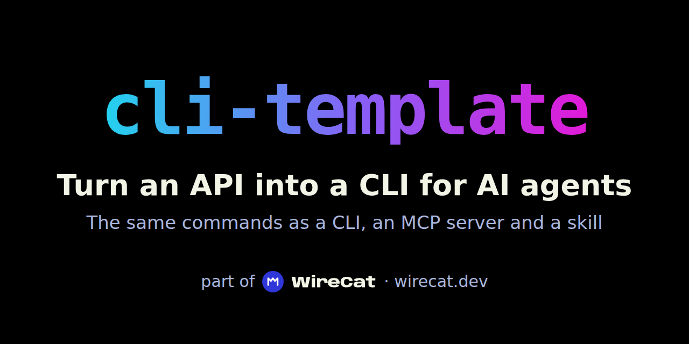
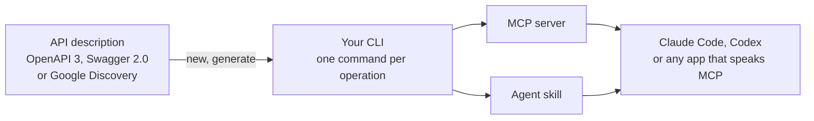

<p align="center">
  
</p>

# cli-template: turn an API into a CLI for AI agents

<p align="center">
  Turn an API description into a CLI your agent can use in Claude Code, Codex or any app that speaks MCP. One
  command gives you the CLI, an MCP server, an agent skill and a test for every operation. When the template
  improves, its upgrade command merges the change into the CLI you already edited.
</p>

<p align="center">
  <a href="https://wirecat.dev/en/docs/build-create-cli">Docs</a> ·
  <a href="https://github.com/WireCatLabs/cli-template/blob/main/kit/README.md">Reference</a> ·
  <a href="https://discord.gg/DebENqbRrJ">Discord</a>
</p>

<p align="center">
  <a href="https://www.npmjs.com/package/@wirecat/cli-template"></a>
  <a href="https://github.com/WireCatLabs/cli-template/actions/workflows/main.yml"></a>
  <a href="https://github.com/WireCatLabs/cli-template/blob/main/LICENSE"></a>
</p>

## Quick start

```sh
npx @wirecat/cli-template new acme-cli --spec openapi   # asks for the command word (acme) and the other answers
cd acme-cli && pnpm install && pnpm generate
node dist/bin/acme.js personal api list                 # one command for each operation of the API
```

`new` asks for every answer it is missing and never guesses one. It starts you on a sample API description of a
made-up service, Example Comments, so the CLI builds and runs before you pick your own service.
[From your API description](#from-your-api-description) shows how to swap it in.



## What you get

```text
acme-cli/
├── spec/acme/openapi.json   the API description, and where it came from
├── src/generated/           types, schemas and a manifest of every operation
├── src/commands/            the api group, the sign-in and your own commands
├── src/api.test.ts          every operation sent to a strict fake of the API
├── skills/                  the agent skill, with pages for the API
├── .github/workflows/       CI, the release and a monthly check
└── bin/release              publishes each version to npm through GitHub
```

- **Your agent gets the API the day you start.** `acme personal mcp serve` serves every command to an agent over MCP,
  and `acme skill install` teaches Claude Code, Codex or Gemini CLI how to use the tool.
- **The token stays in the OS keyring**, under a profile you name, such as `personal` or `work`. No profile is ever
  assumed: a command without one stops and lists the profiles.

## Why cli-template

- **It keeps up after you edit.** `upgrade` merges each template change into your CLI file by file, and asks before
  it touches a file you changed. A one-time generator leaves you to copy its later fixes by hand.
- **One set of commands, three ways in.** The same commands are the CLI, the MCP tools and the skill, so what you
  test is what the agent runs.
- **You decide what an agent may do.** Each profile sets `allow`, `readonly` or `deny` per command and per API
  operation. An operation that deletes needs its own permission key, and the api group refuses to build without one.
- **Tests come with the API.** `src/api.test.ts` sends every operation to a fake built from the description, which
  refuses a request the description does not allow. It also checks that a denied delete stops before anything is sent.
- **Google APIs too.** Besides OpenAPI 3 and Swagger 2.0 it reads Google's Discovery documents.

## How it compares

Checked on the tools' own pages in November 2026. "Not documented" means the page does not say.

| | What it makes | For agents | After you edit it | Tests in the project | License |
| --- | --- | --- | --- | --- | --- |
| **cli-template** | A TypeScript CLI project | MCP server (stdio and HTTP) and a skill, from the same commands | `upgrade` merges template changes | One per operation, against a strict fake | Apache-2.0 |
| [Speakeasy](https://www.speakeasy.com/docs/cli-generation/create-cli.md) | A Go CLI, and an [MCP server](https://www.speakeasy.com/docs/standalone-mcp/build-server) as a separate product | Agent mode for Claude Code, Cursor and others | Not documented | Contract tests, offered as a separate product | Vendor service, the CLI generator labelled alpha in its docs |
| [openapi-mcp-generator](https://github.com/harsha-iiiv/openapi-mcp-generator) | A TypeScript MCP server | MCP only | `--force` writes over your edits | Not documented | MIT |
| [FastMCP `from_openapi`](https://gofastmcp.com/integrations/openapi) | An MCP server built at run time, in Python | MCP only | No code is generated | Not documented | Apache-2.0 |
| [api2cli](https://github.com/alexknowshtml/api2cli) | A Commander.js CLI and a skill, written by a Claude Code skill | A Claude Code skill | A one-time result | None shown | MIT |

What cli-template does not do. It is Node and TypeScript only (Node 22.16 or 24 and later, with pnpm), and it
builds no single binary. It reads JSON descriptions, so convert a YAML one first, and the api group calls one base
URL. The CLI signs in with a token: OAuth is yours to wire up, from cli-core's `oauth` module. The skeleton keeps
no data of its own and has no search.

## From your API description

`new --spec openapi` (or `swagger`, `discovery`) writes the sample description to `spec/<command>/` with a
`provenance.json` that says where it came from. To switch to your service:

1. Put the address of its JSON description in `spec/<command>/provenance.json`.
2. `pnpm spec:sync` downloads it, then `pnpm generate` writes one command per operation, its permissions, its tests
   and the skill's API pages.
3. Read the [OpenAPI guide](kit/skills/new-cli/references/openapi.md) for what to set in `scripts/generate.ts`, such
   as which operations delete.

Run the same two steps when the service changes its API.

## Keep it current

Run `npx @wirecat/cli-template upgrade` in your CLI, with a clean git working tree. For each file the template
changed it offers to merge the change, take the template's file, skip it or show the diff. `--dry-run` lists what
each file would get and writes nothing. The files that are yours from the start, such as your commands in
`src/commands/`, `README.md` and `package.json`, are never touched. The details are in the
[kit reference](kit/README.md#upgrade).

## Have an agent build it

The [new-cli skill](kit/skills/new-cli/SKILL.md) takes an agent from research to the first release, and has a fresh
agent review every part it builds. Its last section is the prompt to fill in. Parts of it assume WireCat's own
repositories, such as where the research is kept.

## Publishing outside WireCat

A CLI made outside WireCat publishes under its own npm scope, such as `@example/acme-cli`. `new` sets it up for that,
with its own MCP Registry name and its own monthly CI run. `bin/setup-github` creates the
repository, and `bin/release --first` publishes the first version from your computer. The steps, with npm trusted
publishing, are in [Publishing outside WireCat](kit/README.md#publishing-outside-wirecat).

## This repository is also the skeleton

`new` copies this repository into your CLI. Its command word is the placeholder `clidev`, which `new` replaces with
yours. It is not `cli-dev`, the developer tool in cli-base. `new` writes a fresh README for each new CLI, so this
page never reaches one.

To work on the template itself:

```sh
pnpm install
pnpm build
node dist/bin/clidev.js doctor
```

The skeleton's own pages describe `clidev` as a user sees it: [install](docs/installation.md),
[use it](docs/usage.md), [settings](docs/configuration.md), [commands](docs/commands.md),
[when something goes wrong](docs/troubleshooting.md) and [security](docs/security.md). The working rules for people
and agents are in [AGENTS.md](AGENTS.md), how `new` and `upgrade` read this repository is in
[kit/DEVELOPING.md](kit/DEVELOPING.md), and `pnpm release:check` runs every check before a release.

Report a vulnerability privately as [SECURITY.md](SECURITY.md) says. The changes are in [CHANGELOG.md](CHANGELOG.md).
